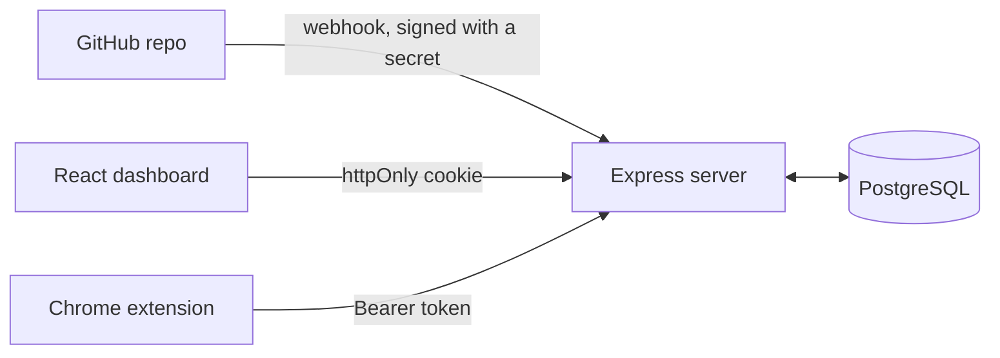

# Kitsune Repo Pet

A pixel-art fox that lives on your GitHub pages and reacts to what happens in your repo. Merge a pull request and it's happy. Break the tests and it gets sick, sits down, and tells you which pull request did it.

**Live site:** https://kitsune-1w6r.onrender.com (the free host sleeps, so the first visit can take about 20 seconds)

## What it does

- **Dashboard:** sign up, connect a GitHub repo, pick and name your pet, set up the webhook, and see your pet's mood and recent events.
- **Chrome extension:** on any page of a connected repo, the fox sits in the corner. Now and then it gets up for a walk. When something happens it speaks, with a link: "PR #12 merged!", "Tests failed on #14", "Tests are passing again".
- **Mood** comes from real GitHub events and is never stored. It is worked out from the events every time:

| Checked in this order                                    | Mood   |
| -------------------------------------------------------- | ------ |
| No events yet                                            | normal |
| The most recent test run failed                          | sick   |
| A pull request merged or tests passed in the last 3 days | happy  |
| Otherwise                                                | normal |

## How it fits together



1. Something happens on GitHub (a pull request merges, a test run finishes). GitHub sends a webhook to our server.
2. The server checks the webhook's signature against that repo's secret, and saves the event.
3. The dashboard and the extension ask the server for the pet. The server works out the mood from the saved events.

The server also serves the built dashboard, so the site and the API share one address. That keeps the login cookie first-party.

## Project structure

| Folder       | What it is                                                                        |
| ------------ | --------------------------------------------------------------------------------- |
| `server/`    | Express + TypeScript API, PostgreSQL                                              |
| `dashboard/` | React + TypeScript dashboard (Vite)                                               |
| `extension/` | Chrome extension (Manifest V3, TypeScript)                                        |
| `shared/`    | Types and event helpers used by all three (`Mood`, `RepoEvent`, `groupEvents`...) |

This is one repo using **npm workspaces**, so a single `npm install` at the root installs everything.

## Getting started

Requires Node 24 (see `.nvmrc`). If you use nvm, run `nvm use`.

```bash
npm install
cp server/.env.example server/.env
```

### Set up your local database

You need PostgreSQL running on your computer. Create a database and its tables:

```bash
createdb kitsune_dev
psql -d kitsune_dev -f server/db/schema.sql
```

Then fill in `server/.env`:

```
DATABASE_URL=postgres://localhost/kitsune_dev
JWT_SECRET=<any long random string>
PUBLIC_URL=http://localhost:3000
```

To generate a `JWT_SECRET`:

```bash
node -e "console.log(require('crypto').randomBytes(32).toString('hex'))"
```

Your local database is yours alone. It's safe to fill with test data or wipe. The shared Supabase database is only used by the deployed app.

`schema.sql` is safe to run again. When it changes, run the same `psql` command to bring your database up to date.

### Run the server and the dashboard

In two terminals:

```bash
npm run dev:server
```

```bash
npm run dev:dashboard
```

Open http://localhost:5173/signup and create an account. You should land on the dashboard. Requests to `/api` are forwarded to the server on port 3000. To check the server on its own, http://localhost:3000/api/health should return `{"status":"ok"}`.

### Build and load the extension

```bash
npm run build:extension
```

In Chrome, go to `chrome://extensions`, turn on **Developer mode**, click **Load unpacked**, and choose `extension/dist`.

There are two builds:

| Command                        | The extension talks to               |
| ------------------------------ | ------------------------------------ |
| `npm run build:extension`      | Your own computer (`localhost:3000`) |
| `npm run build:extension:live` | The live site                        |

After every rebuild: click the reload icon on the extension's card, **and refresh any GitHub tab that was already open**. Tabs keep running the old version until they are refreshed. Switching between the two builds logs you out of the extension, because the saved login belongs to the other server.

Then click the extension's icon to log in, and open a repo you have connected.

### Real webhooks need the live site

GitHub can't reach `localhost`, so real events only arrive on the deployed server. To see the whole thing work: sign up on the live site, connect a repo, and follow the steps on its webhook setup page. You need admin access to the GitHub repo to add a webhook.

## Tests

Create the test database once:

```bash
createdb kitsune_test
psql -d kitsune_test -f server/db/schema.sql
```

Then:

```bash
npm test
```

| Where       | What is tested                                                                                     |
| ----------- | -------------------------------------------------------------------------------------------------- |
| `server`    | Every route against a real database: auth, ownership, repos, pets, webhooks, events, mood          |
| `dashboard` | Every page with React Testing Library, the login guard, the fake API, and the shared event helpers |
| `extension` | The logic with no browser in it: reading a repo from a URL, when to walk, what to say              |

Good to know:

- The server tests **wipe the database before each test**. They refuse to run unless the database name ends in `_test`.
- Don't run the server tests twice at the same time. Two runs share one database and erase each other's data.
- `npm run test:coverage` prints a coverage report for the server.
- CI runs lint, format check, typecheck, and all tests on every pull request (`.github/workflows/ci.yml`), using its own throwaway database.

### The fake API

The dashboard can run without a server's data, on an in-memory fake that has the same shape as the real API. It was how the pages were built before the real routes existed. To use it, create `dashboard/.env.local` (see `dashboard/.env.example`):

```
VITE_USE_MOCKS=true
```

Logging in always uses the real server. The fake is left out of production builds.

## Deployment

- **Server and dashboard:** Render, one service. The build has to install the dependencies and build the dashboard (`npm run build --workspace dashboard`), so that `dashboard/dist` exists when the server starts. Deploys are started by hand in Render for now.
- **Database:** PostgreSQL on Supabase.
- **Environment variables on Render:** `DATABASE_URL`, `JWT_SECRET`, `PUBLIC_URL` (the site's own address), and `NODE_ENV=production`, which makes the login cookie HTTPS-only.

When `server/db/schema.sql` changes, the new statements have to be run on Supabase too (SQL Editor). The file turns on Row Level Security for every table. Supabase puts its own public API in front of the database, and that closes it. Our server connects as the tables' owner and is not affected.

If a change removes or renames something the running code uses, deploy the new code first and change the database second.

## Docs

- [API contract](docs/API.md): every route, its input and output, and the decisions behind them
- [User flow](docs/USER-FLOW.md): every page, how they connect, and why
- [Contributing](CONTRIBUTING.md): branches, commits, and pull requests

## Useful scripts (run from the root)

| Script                         | What it does                               |
| ------------------------------ | ------------------------------------------ |
| `npm run dev:server`           | Runs the API with reload on save           |
| `npm run dev:dashboard`        | Runs the dashboard with reload on save     |
| `npm run build:extension`      | Builds the extension for local development |
| `npm run build:extension:live` | Builds the extension for the live site     |
| `npm test`                     | Runs every test in every package           |
| `npm run test:coverage`        | Server tests with a coverage report        |
| `npm run typecheck`            | Checks TypeScript in every package         |
| `npm run lint`                 | Finds code problems with ESLint            |
| `npm run format`               | Formats all code with Prettier             |
| `npm run format:check`         | Checks formatting without changing it      |

## Known limits

Things we know about and chose not to build for this version:

- **No rate limiting on login.** Nothing stops repeated password guesses.
- **Logging out does not cancel the token.** It clears the cookie, but the token itself stays valid until it expires after 7 days. A real fix needs short-lived tokens or a list of cancelled ones.
- **Every finished GitHub Actions workflow counts as a test result.** A failing deploy workflow would make the fox sick too. Fine while a repo has one workflow.
- **A failed run on any branch makes the fox sick,** not only on the main branch.
- **One character.** Tanuki and Nekomata are shown as "coming soon".
- **One walking frame.** The fox trots across the page. Its legs don't alternate.
- **The live site sleeps** on the free hosting plan, and takes about 20 seconds to wake. GitHub only waits about 10 seconds for a webhook to be answered, so an event that arrives while the site is asleep may be missed. GitHub's "Redeliver" button on the webhook's page sends it again.
